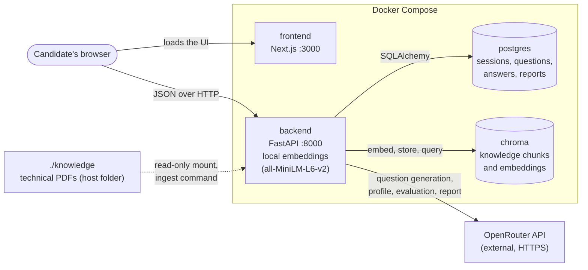

# AI Technical Interview

AI Technical Interview is a role-based practice interview. A candidate uploads a résumé, types the role they are preparing for, and answers technical questions that are generated at runtime from the résumé, the role, and passages retrieved from a technical knowledge base (retrieval-augmented generation, RAG). When every question is answered, the candidate finishes the interview and the app evaluates each answer and saves a final report.

This is a portfolio and internship assignment project. It is not a production recruitment platform, and its feedback is not a hiring assessment.

## Demo

> **TODO: add the end-to-end demo video link here before submission.**
>
> Demo video: `<paste URL here>`

## Features

- **Résumé upload.** PDF or TXT (up to 5 MB). The model extracts a structured profile (summary, skills, technologies, experience) from the text.
- **Free-text role.** The role is typed in; there is no predefined role list.
- **Knowledge ingestion.** A separate command extracts text from technical PDFs, splits it into chunks, embeds them locally, and stores them in Chroma with source title and page.
- **Question generation.** Retrieval queries are built from the role and the candidate profile. The retrieved passages go to an OpenRouter model, which writes the questions. The output is validated before anything is saved.
- **Source references.** Each question stores the chunks it was based on (file, title, page, similarity score). The UI shows "Based on: title, page N".
- **Saved, resumable sessions.** Questions, answers, evaluations and the report are stored in PostgreSQL. Reloading or reopening the interview URL restores progress.
- **Evaluation and report.** Each answer gets qualitative feedback (an assessment label, strengths, gaps, suggestions). A final report summarises strengths, topics to improve and recommendations.
- **Explicit, user-triggered workflow.** Nothing is generated or evaluated automatically: questions start on **Start interview**, and evaluation starts on **Finish interview and get my report**.
- **Responsive frontend** with loading and error states.

## How it works

1. **Create the session.** The candidate enters a role and uploads a résumé. The backend creates an interview session and extracts a candidate profile with the OpenRouter model. Only the profile is saved, not the file.
2. **Retrieve knowledge.** On **Start interview**, the backend builds up to four retrieval queries from the role, profile summary, technologies, skills and experience. It embeds them locally and searches Chroma, keeping chunks above a similarity threshold.
3. **Generate questions.** The best passages (default 8) and the profile go to the model, which returns the configured number of questions (default 5). The backend rejects output that does not validate. Source references are built from the retrieved chunks, never from model-supplied identifiers. If too little relevant material is found (default fewer than 3 passages), no questions are generated and the API says why.
4. **Answer.** Each answer is saved before it is shown as submitted. Answers are write-once.
5. **Evaluate and report.** On **Finish interview and get my report**, the backend evaluates each answer, then writes the report. Retrying is safe: finished evaluations are kept and only missing work is redone.

Questions depend on what is actually retrieved. There is no question bank, canned feedback or fixed report. The topics that can be covered depend entirely on the PDFs you ingest. If your knowledge base does not cover a role or résumé, the app reports insufficient coverage rather than inventing grounding.

**How evaluations use sources.** When a question is generated, the exact text of each cited passage is saved with it as a snapshot. Evaluation judges the answer against those snapshots, not against whatever Chroma holds later, so re-ingesting a document does not change how an existing interview is evaluated. A feedback entry is marked `grounded` only when it cites at least one of its own question's saved passages. If a question has no saved passage text, the answer is still evaluated but is labelled "Evaluated without reference passages", and the report counts how many were. The passage text itself is not returned by the API; only each passage's chunk id, file, title and page (and, for questions, the similarity score) are.

## Architecture



- The browser loads the interface from the `frontend` container and calls the backend API directly, which is why `NEXT_PUBLIC_API_BASE_URL` must be a browser-reachable URL (`http://localhost:8000`).
- The frontend never talks to PostgreSQL, Chroma or OpenRouter. The OpenRouter key exists only in the backend.
- PostgreSQL is the source of truth for application data. Chroma holds only the knowledge chunks, their embeddings and source metadata.
- Embeddings are computed inside the backend container with Sentence Transformers. No embedding API is used.
- PostgreSQL and Chroma are not published to the host; they are reachable only on the Compose network.

## Technology stack

| Area | Technology | Responsibility |
|---|---|---|
| Frontend | Next.js 16, React 19, TypeScript, Tailwind CSS 4 | Résumé and role form, interview screens, report |
| Backend | Python 3.12, FastAPI | REST API, résumé processing, RAG orchestration, OpenRouter requests |
| Database | PostgreSQL 17, SQLAlchemy 2, Alembic | Application data and schema migrations |
| Document parsing | PyMuPDF | Text extraction from résumé PDFs and knowledge PDFs |
| Embeddings | Sentence Transformers, `all-MiniLM-L6-v2` | Local embeddings for chunks and queries |
| Vector store | Chroma 1.4.4 (cosine similarity) | Knowledge chunk storage and retrieval |
| LLM | OpenRouter API | Profile extraction, question generation, evaluation, report |
| Backend tests | Pytest | API, persistence, RAG and validation tests |
| Frontend tests | Vitest, React Testing Library | Component and API-client tests |
| Runtime | Docker, Docker Compose | Runs all four services |

## Project structure

```text
.
├── compose.yaml            # frontend, backend, postgres, chroma
├── .env.example            # configuration template (placeholders only)
├── knowledge/              # put your technical PDFs here (contents are not committed)
├── docs/PRD.md             # product requirements
├── backend/
│   ├── Dockerfile
│   ├── alembic/            # database migrations
│   ├── app/
│   │   ├── api/            # FastAPI routers (health, interviews)
│   │   ├── rag/            # PDF extraction, chunking, embeddings, Chroma store, ingestion, retrieval
│   │   ├── models.py       # SQLAlchemy models
│   │   ├── schemas.py      # Pydantic request/response schemas
│   │   ├── resume.py       # résumé parsing and profile extraction
│   │   ├── question_generation.py
│   │   ├── evaluation.py, reporting.py, completion.py
│   │   ├── openrouter.py   # OpenRouter client and typed errors
│   │   └── config.py       # settings read from environment variables
│   └── tests/
└── frontend/
    ├── Dockerfile
    └── src/
        ├── app/            # pages: / and /interview/[sessionId]
        ├── components/     # interview, answer, report and UI components
        └── lib/            # API client and types
```

## Getting started

### Prerequisites

- Docker with Docker Compose. Node.js, Python, PostgreSQL and Chroma do not need to be installed on the host.
- Network access for the first build and first ingestion (Python and npm packages, CPU PyTorch, and the embedding model download).
- For real interviews: an [OpenRouter](https://openrouter.ai) API key and a model id, and technical PDFs for the knowledge base (see below).

### 1. Configure

```bash
git clone <repository-url>
cd <repository-folder>
cp .env.example .env
```

Edit `.env` and set `OPENROUTER_API_KEY` and `OPENROUTER_MODEL`. Everything else has a working default. `.env` is ignored by Git; never commit it.

### 2. Start the application

```bash
docker compose up --build
```

The first build is slow because it installs PyTorch (CPU) and the other dependencies. The backend applies database migrations automatically on startup (`alembic upgrade head`).

| What | URL |
|---|---|
| Frontend | http://localhost:3000 |
| Backend health | http://localhost:8000/api/health |
| API documentation (Swagger UI) | http://localhost:8000/docs |

To confirm the services are healthy:

```bash
docker compose ps
curl http://localhost:8000/api/health
```

`postgres`, `chroma` and `backend` have health checks and should show `healthy`. The health endpoint returns `{"status":"ok","database":"ok"}`, or HTTP 503 with `"status":"degraded"` if PostgreSQL is unreachable. It does not check Chroma or OpenRouter. The frontend footer also shows whether it can reach the backend.

The Compose setup runs development servers (Next.js dev server, `uvicorn --reload`) with the source folders mounted, so edits reload without a rebuild. It is a local development setup, not a production deployment.

### 3. Add knowledge documents and ingest them

The technical PDFs are **not distributed with this repository** (`knowledge/` is ignored by Git except for a placeholder). Supply the PDFs you want to use, for example the technical books named in the assignment:

1. Copy the PDF files into `./knowledge` (subfolders are included). To use another folder, set `KNOWLEDGE_HOST_DIR` in `.env`. The folder is mounted read-only at `/knowledge` in the backend container.
2. With the stack running, ingest them:

```bash
docker compose exec backend python -m app.rag.ingest
```

Optionally check that retrieval works:

```bash
docker compose exec backend python -m app.rag.retrieval "gradient descent" --top-k 3
```

Notes:

- Ingestion is a separate command and never runs during an interview request. It is repeatable: unchanged files are skipped and changed files are replaced, so chunks are not duplicated.
- It fails with a clear message if the folder is missing or contains no PDFs. PDFs without extractable text (scans; OCR is not supported) are reported and skipped.
- The embedding model downloads on first use and is cached in the `hf_cache` volume.
- Page numbers are the PDF's physical page numbers, which can differ from the page numbers printed in a book.
- Questions can only cover what the ingested documents cover.

### 4. Use the app

1. Open http://localhost:3000, enter a role, and choose a PDF or TXT résumé.
2. Press **Start interview** to generate the questions.
3. Answer each question and press **Submit answer**.
4. Press **Finish interview and get my report**. This makes several model calls and can take a while; your answers are already saved.

Bookmark the `/interview/<session id>` address. There is no login, so that address is how you return to an interview.

### Stopping

```bash
docker compose stop      # stop the services, keep all data
docker compose down      # remove the containers, keep the named volumes (data is kept)
```

Data lives in the named volumes `postgres_data`, `chroma_data` and `hf_cache`. Normal start, stop and restart keep it.

## Environment variables

Copy `.env.example` to `.env`. All values below are placeholders or defaults; set real credentials only in your local `.env`.

### Required for real interviews

| Variable | Used by | Description |
|---|---|---|
| `OPENROUTER_API_KEY` | backend | Your OpenRouter API key. Empty by default. The app starts without it, but résumé processing, question generation, evaluation and the report return HTTP 503 until it is set. |
| `OPENROUTER_MODEL` | backend | An OpenRouter chat model id (see [openrouter.ai/models](https://openrouter.ai/models)). Empty by default; required together with the key. The app expects JSON replies and validates them, so choose a model that follows JSON-only instructions reliably. |

The key is read only by the backend and is never sent to the browser. Real model calls may incur OpenRouter API costs.

### Infrastructure (defaults work)

| Variable | Default | Used by | Description |
|---|---|---|---|
| `POSTGRES_USER`, `POSTGRES_PASSWORD`, `POSTGRES_DB` | `interview`, `change-me`, `interview` | postgres, backend | Database credentials. Change the password if you expose the stack beyond your machine. |
| `CHROMA_HOST`, `CHROMA_PORT` | `chroma`, `8000` | backend | Where the backend reaches Chroma on the Compose network. |
| `NEXT_PUBLIC_API_BASE_URL` | `http://localhost:8000` | frontend | Backend URL used by the browser. Must be reachable from the browser, not the Docker hostname `backend`. |
| `CORS_ORIGINS` | `http://localhost:3000` | backend | Comma-separated origins allowed to call the API. |
| `KNOWLEDGE_HOST_DIR` | `./knowledge` | Compose | Host folder mounted read-only at `/knowledge`. |

### Optional tuning (defaults in `backend/app/config.py`)

| Variable | Default | Description |
|---|---|---|
| `CHROMA_COLLECTION` | `knowledge` | Chroma collection name. |
| `EMBEDDING_MODEL` | `all-MiniLM-L6-v2` | Sentence Transformers model. |
| `CHUNK_SIZE`, `CHUNK_OVERLAP` | `800`, `150` | Chunk length and overlap, in characters. |
| `RETRIEVAL_TOP_K` | `5` | Chunks returned per retrieval query. |
| `RETRIEVAL_MIN_SCORE` | `0.25` | Minimum cosine similarity for a chunk. An uncalibrated starting value, not a validated cutoff. |
| `QUESTION_COUNT` | `5` | Questions per interview. |
| `CONTEXT_CHUNKS` | `8` | Passages passed to the model. |
| `MIN_CONTEXT_CHUNKS` | `3` | Fewer relevant passages than this means no questions are generated. |
| `MAX_RETRIEVAL_QUERIES` | `4` | Retrieval queries built per interview. |
| `MAX_RESUME_BYTES`, `MAX_RESUME_CHARS` | `5242880`, `20000` | Upload size limit; résumé text beyond the character limit is not sent to the model. |
| `OPENROUTER_BASE_URL` | `https://openrouter.ai/api/v1` | OpenRouter endpoint. |
| `OPENROUTER_TIMEOUT_SECONDS`, `LLM_MAX_ATTEMPTS` | `60`, `2` | Per-request timeout; attempts when the model returns invalid output. |

After changing `.env`, apply it with `docker compose up -d` (this recreates containers whose configuration changed).

## API reference

All routes are under `/api`. Interactive documentation is at http://localhost:8000/docs. `{id}` is the session UUID.

| Method | Path | Purpose | Success |
|---|---|---|---|
| `GET` | `/api/health` | API and database health | 200 (503 if the database is down) |
| `POST` | `/api/interviews` | Create a session. Body: `{"role": "..."}` (1 to 100 characters); an optional `candidate_profile` object is also accepted. | 201 |
| `GET` | `/api/interviews/{id}` | Get a session: role, status (`created`, `in_progress`, `completed`), candidate profile | 200 |
| `POST` | `/api/interviews/{id}/resume` | Upload a PDF or TXT résumé (multipart field `file`) and save the extracted profile | 200 |
| `POST` | `/api/interviews/{id}/questions` | Generate the questions (once per session) | 201 |
| `GET` | `/api/interviews/{id}/questions` | List the questions in order, each with its saved answer or `null` | 200 |
| `POST` | `/api/interviews/{id}/questions/{question_id}/answer` | Save an answer. Body: `{"answer_text": "..."}` (1 to 10,000 characters). Write-once. | 201 |
| `POST` | `/api/interviews/{id}/complete` | Evaluate the answers and save the report. Safe to repeat. | 201 created, 200 already existed |
| `GET` | `/api/interviews/{id}/report` | Get the saved report with questions, answers and feedback | 200 |

Common error statuses:

| Status | Meaning |
|---|---|
| 404 | Unknown session or question, or no report yet |
| 409 | State conflict: questions already generated, no profile yet, question already answered, or unanswered questions when completing |
| 413, 415 | Résumé too large, or not a PDF or TXT file |
| 422 | Invalid input, unreadable or empty file, or insufficient relevant knowledge to generate questions |
| 429, 502, 504 | OpenRouter rate limit, provider or invalid-response failure, or timeout |
| 503 | OpenRouter not configured, or Chroma unreachable |

Example:

```bash
curl -s -X POST http://localhost:8000/api/interviews \
  -H 'Content-Type: application/json' \
  -d '{"role": "Machine Learning Engineer"}'
```

## Testing and development

Run commands from the repository root. Backend tests need the Compose stack's PostgreSQL; `docker compose run` starts it if needed.

```bash
# Backend (Pytest). Uses a separate "<database>_test" database, never the development database.
docker compose run --rm backend pytest -q

# Optional backend smoke test of the real embedding model (needs network on first run)
docker compose run --rm backend pytest -q -m real_model

# Frontend unit and component tests (mocked backend)
docker compose run --rm --no-deps frontend npm test

# Frontend lint, type check and production build check
docker compose run --rm --no-deps frontend npm run lint
docker compose run --rm --no-deps frontend npm run typecheck
docker compose run --rm --no-deps frontend npm run build

# Frontend API client against the running backend (needs the stack up; creates no interviews)
docker compose run --rm frontend npm run test:integration
```

Ordinary tests use mocked OpenRouter responses and synthetic data, so they make no live model calls and need no API key.

Database migrations:

```bash
docker compose exec backend alembic current                                      # show the applied revision
docker compose exec backend alembic revision --autogenerate -m "describe change" # after editing app/models.py
docker compose exec backend alembic upgrade head                                 # also runs on startup
```

Review every autogenerated migration before applying it.

## Data handling

| Store | Holds |
|---|---|
| PostgreSQL | Interview sessions (role, status, candidate profile, timestamps), questions (text, topic, difficulty, source references with passage snapshots), answers and their evaluations, and reports |
| Chroma | Knowledge chunks, their embeddings, and source metadata (file, title, page). No interview data. |

- **Résumés.** The uploaded file and its extracted text are processed in memory and are not stored or logged. Only the extracted profile is saved. The résumé text is sent to the OpenRouter model you configure, so do not upload anything you are not willing to send to that provider.
- **Untrusted input.** Résumé text, retrieved passages, role and answers are passed to the model as delimited data with instructions to treat them as reference material, and model output is validated before it is saved. This reduces but cannot eliminate prompt-injection risk.

## Limitations

- **No authentication or user accounts.** Anyone who has an interview URL can open that interview.
- **Practice guidance only.** Feedback is qualitative and AI-generated. It is not a validated measure of ability or hiring suitability, and there is no numeric score.
- **Coverage depends on your documents.** Questions are limited to what the ingested PDFs contain. Scanned PDFs without a text layer are not supported (no OCR).
- **Uncalibrated retrieval.** The similarity threshold and passage counts are starting values, not tuned or validated.
- **Model quality varies.** Output quality, JSON compliance and cost depend on the OpenRouter model you choose.
- **Development configuration.** Compose runs development servers and uses a default database password. It is not hardened for deployment, and no cloud deployment or CI/CD is included.

## Troubleshooting

| Symptom | Likely cause and fix |
|---|---|
| Uploading a résumé, **Start interview** or **Finish** reports that OpenRouter is not configured (HTTP 503) | `OPENROUTER_API_KEY` or `OPENROUTER_MODEL` is empty. Set both in `.env`, then run `docker compose up -d`. |
| Rate-limit, provider or timeout errors (429, 502, 504) | Transient OpenRouter or model problem. Try the same action again; finished work is kept. Check your OpenRouter credit and model id. |
| A service is not `healthy` in `docker compose ps` | Run `docker compose logs backend` (or `postgres`, `chroma`). The backend waits for PostgreSQL and Chroma, and the frontend waits for the backend. Check that ports 3000 and 8000 are free. |
| The page loads but cannot reach the backend | `NEXT_PUBLIC_API_BASE_URL` must be `http://localhost:8000` (browser-reachable), and `CORS_ORIGINS` must include the frontend origin. |
| "The knowledge base is empty" | No PDFs have been ingested. Add PDFs to `./knowledge` and run `docker compose exec backend python -m app.rag.ingest`. |
| "Only N sufficiently relevant passage(s) were found" (422) | The ingested material does not cover this role and résumé well enough. Add more relevant PDFs and re-run ingestion, or try a role and résumé the documents cover. You can inspect scores with `docker compose exec backend python -m app.rag.retrieval "<query>" --min-score 0`. |
| Résumé rejected (413, 415 or 422) | Use a PDF or UTF-8 TXT file under 5 MB that contains selectable text. Scanned or image-only PDFs cannot be read. |
| Ingestion reports `no_text` or `failed` for a PDF | The PDF has no extractable text or cannot be opened. Use a text-based PDF. |
