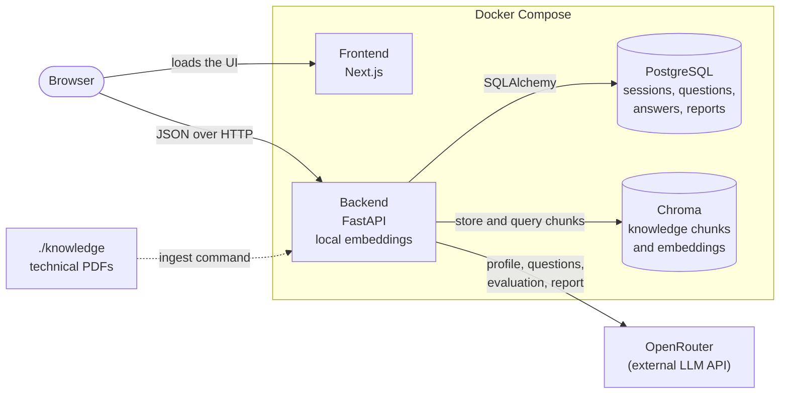

# AI Technical Interview

AI Technical Interview is a practice tool for technical interviews. You provide a resume and a role; the application generates questions informed by your background and by passages retrieved from technical books, saves your answers, and produces a feedback report.

Questions are written at runtime from your resume, the role you type, and the knowledge retrieved for them. There is no fixed question bank.

This is a portfolio and internship project. It is not a production hiring tool, and its feedback is not a hiring assessment.

## Demo

> **TODO:** add the end-to-end demo video link here before submission.
>
> Demo video: `<paste URL here>`

## Features

- **Resume processing.** Upload a PDF or TXT file (up to 5 MB). The model extracts a structured profile: summary, skills, technologies and experience.
- **Any role.** The role is free text. There is no predefined list.
- **Semantic retrieval.** Queries built from the role and profile are embedded locally and matched against the indexed technical books in Chroma.
- **Runtime question generation.** The role, profile and retrieved passages go to an OpenRouter model, which writes the questions. Output is validated before it is saved, and each question keeps references to the passages it was based on.
- **One question at a time.** Answers are saved as you go, with an explicit **Continue to next question** after each successful save. Earlier answers stay available in a collapsed list, and reloading the interview URL restores your place.
- **Saved feedback report.** A summary, strengths, topics to improve and recommendations, plus feedback for each question. Each question's feedback opens and closes independently.

## How it works

1. **Start.** Enter the target role and upload your resume. Reading the resume, which calls the model to extract your profile, happens at this point.
2. **Profile.** The backend saves the extracted profile. The resume file itself is not kept.
3. **Retrieve.** When you click **Start interview**, the backend builds a few queries from the role and profile, embeds them locally and searches Chroma for relevant passages.
4. **Generate.** The role, profile and retrieved passages go to OpenRouter, which returns the questions (five by default). If too little relevant material is found, no questions are generated and you are told why.
5. **Answer and finish.** Each answer is saved immediately. Evaluation and the report are created only when you click **Finish interview and get my report**, and the saved report is displayed.



The browser calls the backend directly; the frontend never talks to PostgreSQL, Chroma or OpenRouter. Built with Next.js, React, TypeScript and Tailwind CSS on the front end, and FastAPI, SQLAlchemy, Alembic, PyMuPDF and Sentence Transformers (`all-MiniLM-L6-v2`) on the back end.

## Quick start

Everything runs in Docker. You do not need Node.js, Python, PostgreSQL or Chroma on your machine.

### 1. Prerequisites

- Docker with Docker Compose v2.24 or newer (the Compose file uses an optional `env_file`).
- Several GB of disk space and network access for the first build.
- An [OpenRouter](https://openrouter.ai) API key and a model id from [openrouter.ai/models](https://openrouter.ai/models). Real requests may incur API costs.
- The knowledge PDFs described under [Knowledge base](#knowledge-base).

### 2. Clone the repository

```bash
git clone https://github.com/Guna-Asher/AI-Technical-Interview.git
cd AI-Technical-Interview
```

### 3. Configure

```bash
cp .env.example .env
```

Set `OPENROUTER_API_KEY` and `OPENROUTER_MODEL` in `.env`. The other settings have working defaults; see [`.env.example`](.env.example). `.env` is ignored by Git. Never commit it.

The app starts without these two values, but reading a resume, generating questions and evaluation return HTTP 503 until they are set.

### 4. Start the services

```bash
docker compose up --build
```

The first build is slow because it installs CPU PyTorch and the other dependencies. The backend applies database migrations automatically on startup.

### 5. Check health

```bash
docker compose ps
curl http://localhost:8000/api/health
```

`postgres`, `chroma` and `backend` should report `healthy` (the frontend has no health check and shows `running`). The health endpoint returns `{"status":"ok","database":"ok"}`. Interactive API documentation is at <http://localhost:8000/docs>.

### 6. Add the knowledge PDFs and ingest them

Copy your PDFs into `./knowledge` (subfolders are included), then, with the stack running:

```bash
docker compose exec backend python -m app.rag.ingest
```

It prints one line per file (`added`, `unchanged`, `replaced`, `no_text` or `failed`), then the total chunk count and `Ingestion complete.` The first run also downloads the embedding model, which is cached in the `hf_cache` volume.

To check retrieval without calling OpenRouter:

```bash
docker compose exec backend python -m app.rag.retrieval "gradient descent" --top-k 3
```

### 7. Try an interview

1. Open <http://localhost:3000>, type a **Job role**, choose a PDF or TXT resume and press **Continue**.
2. Press **Start interview** to generate the questions.
3. Write an answer and press **Submit answer** (or Ctrl/Cmd+Enter), then **Continue to next question**.
4. After the last answer, press **Finish interview and get my report**. This makes several model calls and can take a few minutes. Your answers are already saved.

There is no login. Bookmark the `/interview/<session id>` address to come back to an interview.

### 8. Stop

```bash
docker compose stop    # stop the services and keep all data
docker compose down    # remove the containers; the named volumes (and your data) remain
```

> **Warning:** `docker compose down -v` also deletes the volumes: the PostgreSQL data (all interviews and reports), the Chroma index (you would have to ingest again) and the model cache. Do not use it for routine troubleshooting.

Developed and run on macOS with Docker Desktop. A from-scratch install on a clean machine has not been verified separately.

## Configuration and development

| Variable | Purpose |
|---|---|
| `OPENROUTER_API_KEY` | Your OpenRouter key. Read only by the backend and never sent to the browser. |
| `OPENROUTER_MODEL` | The OpenRouter model id. The app expects JSON replies and validates them, so pick a model that follows JSON-only instructions reliably. |
| `KNOWLEDGE_HOST_DIR` | Host folder with the PDFs (default `./knowledge`), mounted read-only at `/knowledge`. |
| `QUESTION_COUNT` | Questions per interview (default `5`). |
| `RETRIEVAL_MIN_SCORE` | Minimum cosine similarity for a passage (default `0.25`). An uncalibrated starting value. |
| `CHUNK_SIZE`, `CHUNK_OVERLAP` | Chunking in characters (defaults `800`, `150`). Re-run ingestion after changing them. |
| `NEXT_PUBLIC_API_BASE_URL` | Backend URL used by the browser (default `http://localhost:8000`). It must be reachable from the browser, not the Docker hostname `backend`. |

Further tuning options are in [`.env.example`](.env.example) and `backend/app/config.py`. After editing `.env`, run `docker compose up -d` to apply it.

Compose runs development servers (`uvicorn --reload` and the Next.js dev server) with the source folders mounted, so code changes reload without a rebuild.

Tests run in the containers, from the repository root:

```bash
docker compose run --rm backend pytest -q                    # backend; uses a separate "<database>_test" database
docker compose run --rm --no-deps frontend npm test          # frontend unit and component tests
docker compose run --rm --no-deps frontend npm run lint
docker compose run --rm --no-deps frontend npm run typecheck
docker compose run --rm --no-deps frontend npm run build
```

Ordinary tests use mocked OpenRouter responses and synthetic data, so they need no API key and make no live model calls.

The database schema is applied automatically at startup. If you change `backend/app/models.py`, create a migration with `docker compose exec backend alembic revision --autogenerate -m "describe change"` and review it before committing.

## Knowledge base

Questions are grounded in four technical references:

- *The Hundred-Page Machine Learning Book*, Andriy Burkov
- *Artificial Intelligence, Machine Learning, and Deep Learning*, Oswald Campesato
- *Pattern Recognition and Machine Learning*, Christopher M. Bishop
- *Introduction to Machine Learning with Python: A Guide for Data Scientists*, Andreas C. Müller and Sarah Guido

The PDFs are not included and are not meant to be committed (`knowledge/` is ignored by Git except for a placeholder). Supply copies you are authorized to use.

Ingestion is a separate, repeatable command. It extracts text from each PDF with PyMuPDF, splits it into overlapping chunks, embeds them locally and stores them in Chroma with the source title and page. Unchanged files are skipped and changed files are replaced, so running it again does not duplicate chunks. Page numbers are the PDF's physical pages, which can differ from the numbers printed in the book. Scanned PDFs without a text layer are skipped, because there is no OCR.

What can be asked depends on what is retrieved. This collection is mainly about machine learning and data science, so roles in those areas fit best. For other roles, or when, by default, fewer than three passages clear the similarity threshold, the app does not invent grounding: it generates no questions and explains that coverage is insufficient.

## Design decisions and limitations

- **PostgreSQL** holds the application records: sessions, questions, answers and reports. **Chroma** holds only the knowledge chunks, their embeddings and source metadata.
- **Embeddings run locally** in the backend container. **OpenRouter** handles all language-model requests, through the backend only.
- **Resumes are not retained.** The file and its text are processed in memory and only the extracted profile is saved. The resume text is sent to the OpenRouter model you configure, so do not upload anything you would not share with that provider.
- **Stable evaluation.** Answers are write-once, and each question stores a snapshot of the passages it was based on, so re-ingesting a book later does not change how an existing interview is evaluated.
- **Model output is validated** before it is saved, and resume text, passages and answers are passed to the model as delimited data. That reduces prompt-injection risk but cannot remove it.
- **Feedback is qualitative practice guidance.** It is AI-generated, has no numeric score, and is not a validated measure of ability or hiring suitability.
- **No authentication.** Anyone with an interview URL can open that interview.
- **Development configuration.** Compose uses development servers and a default database password (`change-me`). It is not hardened for deployment, and no deployment or CI setup is included.
- **Retrieval is uncalibrated.** The similarity threshold and passage counts are starting values, and output quality depends on the model you choose.

## API and troubleshooting

All routes are under `/api`; the full interactive reference is at <http://localhost:8000/docs>.

| Route | Purpose |
|---|---|
| `GET /api/health` | API and database health |
| `POST /api/interviews` | Create a session from a role |
| `GET /api/interviews/{id}` | Read a session |
| `POST /api/interviews/{id}/resume` | Upload a resume and save the extracted profile |
| `POST /api/interviews/{id}/questions` | Generate the questions, once per session |
| `GET /api/interviews/{id}/questions` | List the questions with any saved answers |
| `POST /api/interviews/{id}/questions/{question_id}/answer` | Save an answer |
| `POST /api/interviews/{id}/complete` | Evaluate the answers and save the report |
| `GET /api/interviews/{id}/report` | Read the saved report |

<details>
<summary>OpenRouter is not configured (HTTP 503), or rate-limit and timeout errors</summary>

Set both `OPENROUTER_API_KEY` and `OPENROUTER_MODEL` in `.env`, then run `docker compose up -d`. Rate-limit, provider and timeout errors (429, 502, 504) are usually temporary: try the same action again. Saved answers and finished evaluations are kept. Also check your OpenRouter credit and model id.
</details>

<details>
<summary>A service is not healthy, or the page cannot reach the backend</summary>

Run `docker compose logs backend` (or `postgres`, `chroma`) and check that ports 3000 and 8000 are free. If the page loads but cannot reach the backend, `NEXT_PUBLIC_API_BASE_URL` must be `http://localhost:8000` and `CORS_ORIGINS` must include the frontend's origin.
</details>

<details>
<summary>The resume is rejected</summary>

Use a PDF or UTF-8 TXT file under 5 MB that contains selectable text. Scanned or image-only PDFs cannot be read.
</details>

<details>
<summary>"The knowledge base is empty" or "Only N sufficiently relevant passage(s) were found"</summary>

The first means nothing has been ingested yet: add PDFs to `./knowledge` and run the ingest command. The second means the indexed books do not cover this role and resume well enough. Add more relevant PDFs and ingest again, or try a role the books cover. To inspect similarity scores, run `docker compose exec backend python -m app.rag.retrieval "<query>" --min-score 0`.
</details>
